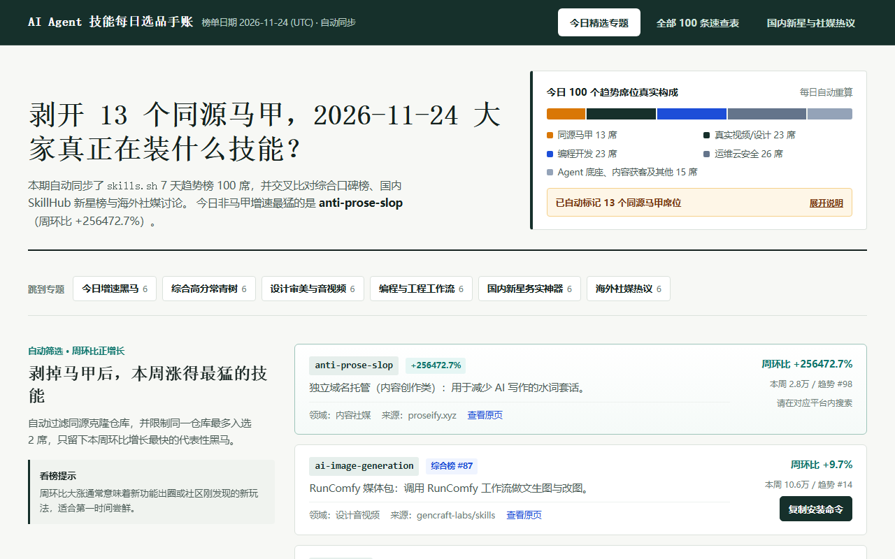
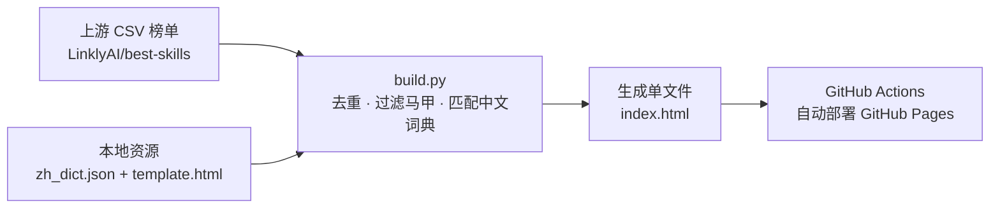

# AI Agent 技能每日选品手账

[](https://github.com/BiaoBB/best-skills-daily/actions/workflows/daily-update.yml)
[](https://biaobb.github.io/best-skills-daily/)
[](./build.py)
[](./.github/workflows/daily-update.yml)

> [!TIP]
> **👉 在线打开网页**：[点击直接进入《AI Agent 技能每日选品手账》](https://biaobb.github.io/best-skills-daily/)
>
> 直达网址：https://biaobb.github.io/best-skills-daily/ （每天自动更新，支持电脑、iPad、手机浏览器直接访问）

## 页面预览



## 为什么做这个项目

社区里好用的 AI Agent Skill（如 Claude Code、Codex、Antigravity 等通用技能）更新非常快，但上游榜单仓库（`LinklyAI/best-skills`）直接看原始 CSV 存在三个痛点：

1. **全英文难快速扫读**：新上榜技能没有大白话中文说明，很难一眼判断是干嘛的；
2. **同源马甲刷屏**：热榜里经常出现同一个套件或克隆仓库刷满前几页，真正值得装的新东西被埋没；
3. **跨榜单对照麻烦**：趋势黑马、综合常青树、国内新星、海外社媒讨论分散在不同文件里。

因此做了这套**全自动脱水选品流水线**：每天定时拉取最新榜单数据、自动识别并剔除同源克隆马甲、匹配本地中文词典，最终编译为一份打开就能看的单文件中文选品手账。

## 核心特性

- **6 大每日自动脱水专题**：
  - **今日增速黑马**：筛选周环比正增长、且剥离同源马甲后的高增长代表技能；
  - **综合高分常青树**：交叉比对 `best-100` 综合评分榜（`wis` 维度），适合新搭环境优先装机；
  - **设计审美与音视频** / **编程与工程工作流**：按本周安装量挑选高人气落地工具（同仓库单专题最多占 2 席防刷屏）；
  - **国内近 30 天新星榜**：同步 `rising-stars.csv`，聚焦国内生态下实用向新晋工具；
  - **海外技术圈社媒热议**：同步 `social-buzz.csv`，汇总近 7 天 X、Hacker News、Bluesky 与 GitHub 上的真实讨论热度。
- **自动防刷屏与马甲识别**：基于 `zh_dict.json` 内置的同源仓库规则过滤克隆刷榜项，保证榜单信息密度。
- **零成本本地中文词典**：`zh_dict.json` 已收录 109 条中文大白话译介（100 条精准源匹配 + 9 条通用兜底），覆盖 13 个技能分类，随时可手动增补。
- **GitHub Actions 全自动更新**：每天北京时间 **10:17**（`UTC 02:17`）自动拉取构建并部署到 GitHub Pages（内置部署重试兜底），也可在仓库 `Actions` 页面一键手动触发即时刷新。
- **零依赖单文件静态网页**：`build.py` 仅使用 Python 标准库，生成的 `index.html` 不依赖任何外部 CDN，在电脑与 iPad 本地离线同样秒开。

## 工作原理



## 目录结构

```text
best-skills-daily/
├── index.html                           # 最新构建生成的单文件静态网页（Pages 入口）
├── build.py                             # 零第三方依赖 Python 构建脚本
├── zh_dict.json                         # 本地中文大白话词典与同源马甲识别规则
├── template.html                        # 静态页面 HTML/CSS/JS 模板
├── assets/
│   └── preview.png                      # README 页面预览图
├── .github/
│   └── workflows/
│       └── daily-update.yml             # 每日定时构建与自动发布 Pages 工作流
└── .gitignore                           # 忽略 Python 缓存等临时文件
```

## 本地使用与日常维护

### 1. 本地手动构建预览

只需本地装有 Python 3（无需 `pip install` 任何第三方包）：

```bash
git clone https://github.com/BiaoBB/best-skills-daily.git
cd best-skills-daily
python build.py
```

运行完成后会在当前目录生成最新的 [`index.html`](./index.html)，直接用浏览器打开即可。

### 2. 给新上榜技能补充中文介绍

如果在页面里看到刚上榜的英文技能暂未翻译，打开 [`zh_dict.json`](./zh_dict.json)，在 `by_source_skill`（按 `仓库名:技能名` 精确匹配）或 `by_skill_fallback` 中加一行中文大白话说明，提交推送后会自动生效。

### 3. 手动触发立即更新

进入 GitHub 仓库顶部的 **Actions** → 左侧选择 **每日自动更新 Best Skills 中文手账并发布** → 点击右侧 **Run workflow**，等待约半分钟即可刷新线上网页。

## 数据来源与协议

- Data from Best Skills (https://github.com/LinklyAI/best-skills) by @BlueeonY — CC BY 4.0
